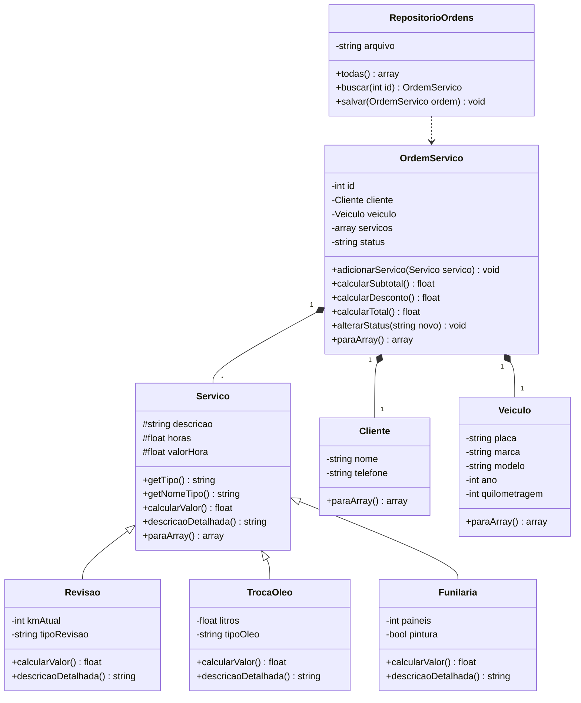

# MotorPrime

> **Vídeo (até 10 min):** [cole aqui o link do vídeo (YouTube não listado ou Google Drive)](#)

Sistema web orientado a objetos em PHP para gestão de ordens de serviço de uma **oficina mecânica**.

| | |
|---|---|
| **Aluno** | Breno França de Sousa |
| **Disciplina** | Programação Web I, Tecnologia em ADS, IFCE Campus Boa Viagem |
| **Professor** | Prof. Dr. Renato William Rodrigues de Souza |
| **Tema** | 12, Oficina Mecânica (`Servico`: revisão, troca de óleo, funilaria; `OrdemServico`) |
| **Relatório** | [docs/relatorio.pdf](docs/relatorio.pdf) |

## Sumário

1. [Apresentação](#1-apresentação)
2. [Como executar](#2-como-executar)
3. [Telas](#3-telas)
4. [Rotas](#4-rotas)
5. [Funcionalidades](#5-funcionalidades)
6. [Regras de negócio](#6-regras-de-negócio)
7. [Modelagem](#7-modelagem)
8. [Requisitos atendidos](#8-requisitos-atendidos)
9. [Estrutura do repositório](#9-estrutura-do-repositório)
10. [Testes](#10-testes)
11. [Uso de LLM](#11-uso-de-llm)
12. [Uso do GitHub](#12-uso-do-github)

---

## 1. Apresentação

O **MotorPrime** controla as ordens de serviço de uma oficina: quem é o cliente, qual é o veículo, quais serviços serão feitos (revisão, troca de óleo, funilaria ou mão de obra avulsa), quanto custa cada um e em que etapa está o trabalho.

O problema é comum em oficinas pequenas: as ordens ficam em papel ou em caderno, os cálculos são refeitos à mão, serviços são esquecidos ou cobrados duas vezes e não existe histórico confiável. O sistema registra tudo em um só lugar, calcula os valores com regras fixas, recusa dados inválidos e mostra o andamento das ordens em um quadro por status. Ele serve ao atendente, ao mecânico-chefe e ao dono da oficina.

## 2. Como executar

**Requisito:** PHP 8.1 ou mais novo (testado com PHP 8.3). Não precisa de banco de dados nem de Composer.

Dentro da pasta do repositório:

```bash
php -S localhost:8000 -t public -d display_errors=1 -d output_buffering=0
```

Depois abra <http://localhost:8000/>. A opção `-t public` define `public/` como a pasta pública do site.

Para rodar o roteiro de testes no terminal:

```bash
php teste.php
```

> As ordens criadas pelo formulário são gravadas em `data/ordens.json` (bônus de persistência). O arquivo é criado sozinho na primeira ordem e está no `.gitignore`. Para zerar os dados, apague esse arquivo.

## 3. Telas

<!-- Tire os prints no navegador e salve em docs/img/. Depois, troque os textos abaixo pelas imagens. -->

| Tela | Print |
|---|---|
| Quadro (`?pagina=inicio`) | `` |
| Lista de ordens (`?pagina=ordens`) | `` |
| Detalhe da ordem (`?pagina=ordem&id=1`) | `` |
| Nova ordem com erro de validação (`?pagina=nova`) | `` |

## 4. Rotas

| Rota | O que faz |
|---|---|
| `?pagina=inicio` | Quadro com as ordens por status. Com `&formato=json`, devolve o resumo em JSON. |
| `?pagina=ordens` | Lista de ordens. Com `&formato=json`, devolve todas em JSON. |
| `?pagina=ordem&id=N` | Detalhe da ordem. Com `&formato=json`, devolve a ordem em JSON. Por POST: `acao=adicionar_servico` ou `acao=alterar_status`. |
| `?pagina=nova` | Formulário POST que cria cliente, veículo, ordem e o primeiro serviço. Se uma regra recusar, a mensagem da exceção aparece na página. |
| qualquer outra | Status **404** (HTML, ou JSON com `{"erro": ...}` quando pedido `formato=json`). |

A rota JSON responde com `Content-Type: application/json; charset=utf-8`, é montada com `paraArray()` e `json_encode` e aceita somente GET (outro método devolve 405).

Exemplos com `curl.exe` (Windows) ou `curl`:

```bash
# JSON de uma ordem
curl.exe -i "localhost:8000/?pagina=ordem&id=1&formato=json"

# Ordem que não existe: 404
curl.exe -i "localhost:8000/?pagina=ordem&id=99"

# Formulário com placa inválida: a mensagem de erro aparece na página
curl.exe -i -X POST "localhost:8000/?pagina=nova" -d "cliente_nome=Maria Souza&cliente_telefone=88999991234&veiculo_placa=XX&veiculo_marca=Fiat&veiculo_modelo=Uno&veiculo_ano=2012&veiculo_km=85000&servico_tipo=troca_oleo&servico_descricao=Oleo&servico_horas=1&servico_valor_hora=90&litros=4&tipo_oleo=sintetico"
```

## 5. Funcionalidades

- **Quadro:** ordens em quatro colunas (aberta, em andamento, finalizada e cancelada) e faturamento das finalizadas.
- **Lista de ordens:** número, abertura, cliente, veículo, quantidade de serviços, total e status.
- **Detalhe da ordem:** dados do cliente e do veículo, serviços com subtotal, desconto e total, mudança de status e formulário para adicionar outro serviço.
- **Nova ordem:** formulário POST com recusa de dados inválidos.
- **Rota JSON** no quadro, na lista e no detalhe.
- **404** para página ou ordem inexistente.
- **Persistência** em `data/ordens.json`.
- **Roteiro de testes** no terminal.

## 6. Regras de negócio

São 22 regras recusadas com `throw new Exception(...)` e tratadas com `try/catch`.

| Nº | Regra | Onde está |
|---|---|---|
| 1 | Nome do cliente com no mínimo 3 caracteres | `Cliente::setNome()` |
| 2 | Telefone com DDD (10 ou 11 dígitos) | `Cliente::setTelefone()` |
| 3 | Placa no padrão antigo (ABC1234) ou Mercosul (ABC1D23) | `Veiculo::setPlaca()` |
| 4 | Ano do veículo entre 1980 e o ano seguinte ao atual | `Veiculo::setAno()` |
| 5 | Quilometragem não negativa e que nunca diminui | `Veiculo::setQuilometragem()` |
| 6 | Descrição do serviço com no mínimo 3 caracteres | `Servico::__construct()` |
| 7 | Horas de mão de obra entre 0,5 e 40 | `Servico::__construct()` |
| 8 | Valor da hora maior que zero | `Servico::__construct()` |
| 9 | Tipo de revisão deve ser `basica` ou `completa` | `Revisao::__construct()` |
| 10 | Quilometragem da revisão entre 0 e 1.000.000 | `Revisao::__construct()` |
| 11 | Revisão completa exige 3 h ou mais (básica, 1 h) | `Revisao::__construct()` |
| 12 | Tipo de óleo: mineral, semissintético ou sintético | `TrocaOleo::__construct()` |
| 13 | Quantidade de óleo entre 1 e 10 litros | `TrocaOleo::__construct()` |
| 14 | Troca de óleo com no máximo 2 h de mão de obra | `TrocaOleo::__construct()` |
| 15 | Funilaria atende entre 1 e 8 painéis | `Funilaria::__construct()` |
| 16 | Cada painel exige pelo menos 2 h de mão de obra | `Funilaria::__construct()` |
| 17 | Só aceita serviços se a ordem está aberta ou em andamento | `OrdemServico::adicionarServico()` |
| 18 | No máximo 5 serviços por ordem | `OrdemServico::adicionarServico()` |
| 19 | Não repetir o mesmo tipo de serviço (exceto mão de obra avulsa) | `OrdemServico::adicionarServico()` |
| 20 | O status informado precisa existir | `OrdemServico::alterarStatus()` |
| 21 | Só são permitidas as transições do fluxo de status | `OrdemServico::alterarStatus()` |
| 22 | Não avançar uma ordem que não tem serviços | `OrdemServico::alterarStatus()` |

**Regras de cálculo.** O valor de cada serviço é a mão de obra (horas × valor da hora) mais um adicional que depende do tipo:

| Serviço | Adicional |
|---|---|
| Revisão | R$ 80,00 (básica) ou R$ 220,00 (completa) |
| Troca de óleo | filtro R$ 35,00 + litros × preço do litro (mineral R$ 28,00, semissintético R$ 42,00, sintético R$ 65,00) |
| Funilaria | R$ 350,00 de material por painel; com pintura, mais R$ 420,00 por painel |
| Mão de obra avulsa | nenhum |

A ordem com **3 ou mais serviços** recebe **10% de desconto** (`OrdemServico::calcularDesconto()`).
O fluxo de status é `aberta → em andamento → finalizada`, e a ordem pode ser cancelada antes de finalizar.

## 7. Modelagem



`<|--` é herança (é um), `*--` é composição (tem um), `#` é protected, `-` é private e `+` é public. Imagem do mesmo diagrama: [docs/diagrama.png](docs/diagrama.png). Mais detalhes em [docs/modelagem.md](docs/modelagem.md).

**Herança.** A classe mãe é `Servico` e as filhas são `Revisao`, `TrocaOleo` e `Funilaria`. A relação "é um" vale para as três. Todas têm descrição, horas e valor da hora (na mãe, como `protected`), mas cada uma calcula o valor e descreve o serviço de um jeito, por isso sobrescrevem `calcularValor()`, `descricaoDetalhada()`, `getTipo()`, `getNomeTipo()` e `paraArray()`. A classe `Servico` não é abstrata de propósito: sozinha ela representa a mão de obra avulsa, que existe de verdade na oficina. Interfaces não foram usadas.

**Composição.** `OrdemServico` guarda uma lista de `Servico` e também um `Cliente` e um `Veiculo`: a relação é "tem um". Os serviços só fazem sentido dentro de uma ordem, que decide se aceita cada um (regras 17 a 19) e calcula subtotal, desconto e total percorrendo a lista. `RepositorioOrdens` apenas usa a ordem para gravá-la e lê-la em JSON (seta tracejada).

## 8. Requisitos atendidos

| Requisito | Onde aparece |
|---|---|
| **OO1** Pelo menos 5 classes, com construtor, atributos tipados e `declare(strict_types=1)` | 8 classes em `src/` |
| **OO2** Hierarquia com `extends`, `parent::__construct` e sobrescrita | `Servico` → `Revisao`, `TrocaOleo`, `Funilaria` |
| **OO3** Polimorfismo com `foreach` | `OrdemServico::calcularSubtotal()`, página da ordem em `public/index.php` e `teste.php` |
| **OO4** Nenhum atributo `public` | Atributos `private`/`protected`, getters e setters com validação |
| **OO5** Pelo menos 3 regras com `throw` e `try/catch` | 22 regras (seção 6), tratadas em `public/index.php` e `teste.php` |
| **OO6** Composição com adicionar e calcular | `OrdemServico::adicionarServico()` e `calcularTotal()` |
| **OO7** `paraArray()` nas classes do JSON | Todas as classes de domínio |
| **OO8** Uma classe por arquivo em `src/`, com `require_once` | `src/*.php` |
| **W1** Páginas por `?pagina=`, mesmo cabeçalho e menu, 404 | `public/index.php` |
| **W2** `?formato=json` com `Content-Type` correto | `responderJson()` em `public/index.php` |
| **W3** Formulário POST que cria objeto e mostra a exceção | Página `nova` |
| **W4** `htmlspecialchars` em todo dado exibido | Função `e()` |
| **W5** Lógica PHP no topo, HTML depois | `public/index.php` |
| **Bônus** Persistência em JSON | `src/RepositorioOrdens.php` e `data/ordens.json` |

## 9. Estrutura do repositório

```text
pweb1-trabalho-oo/
├── README.md
├── teste.php                  # roteiro de testes no terminal
├── .gitignore
├── data/
│   └── .gitkeep               # ordens.json é criado aqui
├── docs/
│   ├── modelagem.md           # diagrama de classes (Mermaid) e justificativas
│   ├── diagrama.png
│   ├── testes.md              # saídas do terminal de cada regra
│   ├── llm.md                 # diário de uso de LLM
│   └── relatorio.pdf          # relatório final
├── public/
│   ├── index.php              # páginas, formulário e rota JSON
│   └── estilo.css
└── src/
    ├── Cliente.php
    ├── Veiculo.php
    ├── Servico.php
    ├── Revisao.php
    ├── TrocaOleo.php
    ├── Funilaria.php
    ├── OrdemServico.php
    └── RepositorioOrdens.php
```

## 10. Testes

```bash
php teste.php
```

O script mostra, em sequência, cada regra aceita e cada recusa, e termina com código 1 se algum teste falhar. Ele cobre cliente, veículo, as regras de cada serviço, o polimorfismo (com os valores conferidos à mão), a composição e o desconto, o fluxo de status, `paraArray()` e a persistência em JSON. Exemplo do final da saída:

```text
OK, recusado (6º serviço (limite de 5)): Uma ordem de serviço aceita no máximo 5 serviços.
...
Resultado: todos os testes passaram.
```

A saída completa, com a explicação de cada bloco, está em [docs/testes.md](docs/testes.md).

## 11. Uso de LLM

Foi usado o **Claude** (Anthropic) como ferramenta de aprendizado: para organizar as classes, entender encapsulamento, herança e polimorfismo, exceções e a camada web. Uma sugestão que não atendia ao requisito OO4 (atributos públicos) foi percebida e corrigida para atributos privados com getters e setters. O diário completo, com prompts, resumos e decisões, está em [docs/llm.md](docs/llm.md).

## 12. Uso do GitHub

- **Issues:** uma por funcionalidade, fechadas pelo commit (`closes #N`).
- **Branches e pull requests:** cada funcionalidade em uma branch, unida à `main` por pull request.
- **Commits:** padrão Conventional Commits (`feat:`, `docs:`, `test:`, `style:`), pequenos e distribuídos ao longo do prazo. Nos commits com ajuda relevante de LLM, última linha `Assistido-por: Claude`.
- **Tags dos marcos:** `v0.1-modelagem`, `v0.2-nucleo` e `v1.0-entrega`.

---

Feito por **Breno França de Sousa** · Programação Web I · IFCE Campus Boa Viagem · 2026
