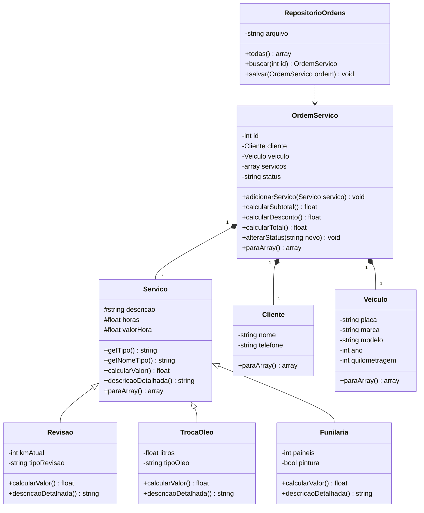

# Modelagem: Oficina MotorPrime

## Justificativas

- **Herança (Servico → Revisao, TrocaOleo, Funilaria):** os três são serviços (relação "é um"),
  compartilham descrição, horas e valor da hora, mas cada um calcula o valor de um jeito
  (taxa de checklist, litros de óleo mais filtro, material e pintura por painel).
- **Composição (OrdemServico tem Servico, Cliente e Veiculo):** os serviços só existem dentro da
  ordem ("tem um"). A ordem calcula subtotal, desconto e total percorrendo a lista.
- **Repositório:** isola a gravação em JSON, para que as classes de domínio não saibam nada de arquivos.
